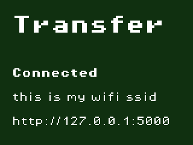
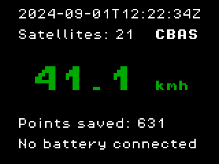
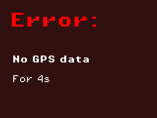
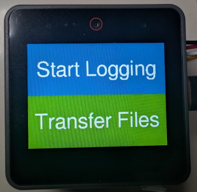
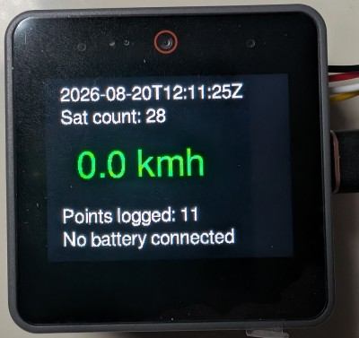

# GPS Logger (M5Stack CoreS3)

A GPS data logger built using CircuitPython and tested on the
**M5Stack CoreS3**.

It reads NMEA sentences from a **Unicore UM980** GNSS receiver over UART,
displays a basic dashboard including speed and battery status (via an AXP2101 
PMIC), and logs positions to an SD card as custom CSV files.

Additionally, it can connect to a (pre-defined) 2.4GHz Wi-Fi AP and expose
a web server with a REST API, allowing the CSV files to be automatically downloaded.


## Status

 * Still just a proof of concept
 * Ran successfully at 1 Hz for over 2 hours


## Screenshots

| Startup/Logger                    | Transfer/Error                     |
|-----------------------------------|------------------------------------|
|  |  |
|   |     |


### Older UI (on hardware)"

| Startup Screen                          | Main Logging Screen      |
|-----------------------------------------|--------------------------|
|  |  |  

*(Yes it's upside down, I drilled holes before checking where the cable had to reach)*


## Getting started

### Required Hardware

| Component     | Details                                                                    |
|---------------|----------------------------------------------------------------------------|
| MCU board     | M5Stack CoreS3 (ESP32-S3)                                                  |
| GNSS receiver | Unicore UM980. Port A/B Grove (TX/RX wiring may be swapped!) @ 115200 baud |
| Storage       | MicroSD card                                                               |
| Firmware      | Adafruit CircuitPython 10.x  (Nightly with SPI fix)                        |


### Software

* Copy `src/config.py.sample` to `src/config.py` and make any required changes
* Copy **all** files in `src/` to the MCU.
* Start the MCU and watch for errors on the screen or in the serial console.


### Log files

Log files are saved onto the SD card periodically.  The time between writes 
can be set via the config file (20-40s is good range).

Position data is saved as a CSV files rather than GPX due to the reduced size 
and ease of access.

To get the logs off the device there are three options:

1. Remove the SD Card from the M5Stack and copy the CSV files manually.

2. Enter file transfer mode, and use a browser to download the CSV files
   from `http://ip:5000/`.  (This requires the device to be connected to an AP)

3. Enter file transfer mode, and use the `sync_data.py` script to download all logs 
   to the `./data/` directory, automatically  convert them to GPX, and optionally 
   delete them from the SD card. **Recommended**


### Log format

Logs are named `[yyyymmdd]_[hhmmss]Z.csv`

**Example:**
```
timestamp,latitude,longitude,altitude,speed,num_satellites,hdop
2026-08-15T14:30:00Z,-47.276949070,142.138929220,12.34,42.65,12,0.9
```

- `timestamp` — UTC, `YYYY-MM-DDTHH:MM:SSZ`
- `latitude`/`longitude` — decimal degrees
- `altitude` — metres (GGA)
- `speed` — km/h (RMC overground speed, knots × 1.852)
- `num_satellites` — satellite count (GGA)
- `hdop` — horizontal dilution of precision (GGA)


### GPS configuration

The receiver is configured on every boot using the commands in `src/config.py`.

The default commands are for a Unicore UM980 and enable SBAS for Australia.

```
unlogall                     # disable all nmea messages
config signalgroup 2         # switch to signal group 2  (GNSS frequency preset)
mode rover                   # rover  (not a base station)
config sbas enable span      # enable SBAS for SouthPAN  (Australia)
gpgga 1                      # log GGA messages  (fix details)
gprmc 1                      # log RMC message   (speed time & date)
version
```


## Development

### Project layout

```
  .
  ├── deploy.sh                          # Shell script to copy code to M5Stack device
  ├── sync_data.py                       # Python script to download CSV files from web API and convert into GPX
  ├── sync_data.last_ip                  # Cache file holding the last used IP address
  ├── data/                              # sync_data.py will place CSV and GPX files here 
  └── src/ 
      ├── code.py                        # Main M5Stack program
      ├── config.py                      # Holds SSID/Password and other settings (gitignored, copy from config.py.sample)
      ├── config.py.sample               # Template for config.py
      ├── gps.py                         # Parses multiple messages and presents a "GPSState"
      ├── local_ui_test.py               # Uses `blinka-displayio-pygamedisplay` to show UI pages locally
      ├── nano_degrees.py                # Integer-math lat/long type (decimal degrees at nano-degree precision)
      ├── nmea.py                        # Parses raw nmea messages into typed objects
      ├── ui.py                          # UI Code split so it can be shared between device, and local testing
      ├── fonts/                         # PCF fonts from PixelOperator 
      ├── lib/
      │   ├── axp2101.py                 # AXP2101 PMIC driver (Adafruit)
      │   ├── adafruit_focaltouch.mpy    # FT6336U touch driver (Adafruit)
      │   ├── adafruit_bitmap_font/      # Bitmap font loader (Adafruit)
      │   ├── adafruit_display_text/     # Text UI library (Adafruit)
      │   └── adafruit_httpserver/       # HTTP Webserver (Adafruit)
      └── sd/
          └── placeholder.txt            # Make sure SD mount point is present
```


### TODO

* Check if I can just use `BESTNAV` rather than combining `GGA` + `RMC`.
* Test what happens if the AP isn't found, or there is an incorrect password
* Update PageBase to keep track of the last root_group assignment and to skip redundant assignments 
* GGA and RMC don't have UTC milliseconds.   This is needed for rates above 1hz  (even 1hz could be 0.999 ms out).
* Separate the CSV → GPX tool into a separate script
* Allow transfer mode to create its own Wi-Fi AP
* Add a "safe shutdown" function  (flush the buffer to the SD card, and stop).


### Issues

Accessing the SD Card *and* the Display at the same time doesn't seem to be
possible as the CoreS3 re-used the SPI MISO pin for the DC pin of the LCD.

This probably isn't a big deal if you were writing the code in C, but it
requires a workaround for CircuitPython.  The workaround seems okay, but it 
does make the screen redraw when switching between the two devices.

For a logger, I'm prepared to live with this.

On a related note, if you have trouble running CircuitPython 10.x, make sure 
you're using firmware that includes PR11155, such as:
`adafruit-circuitpython-m5stack_cores3-en_US-20260731-main-PR11155-719f88d.bin`


### References

- [UM980 configuration commands](https://www.ardusimple.com/how-to-configure-unicore-um980-um981-um982/#Frequently-used-commands)
- [NMEA-0183 GGA message](https://receiverhelp.trimble.com/alloy-gnss/en-us/NMEA-0183messages_GGA.html)
- Fonts from https://github.com/adafruit/circuitpython-fonts
- PRN 122 or 139 are SouthPAN SBAS
- Pixel Operator fonts by Jayvee Enaguas (HarvettFox96)


### AI Disclaimer

* All CircuitPython code (and bugs) written by a human.
* `sync_data.py` created by GLM 5.2  (because I was too lazy)


### License

MIT
